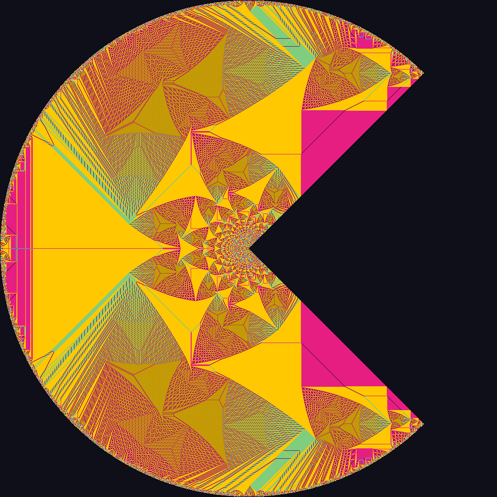

# CS598APE HW3

This repository contains code for homework 3 of CS598APE. It is relatively
simple in comparison to HW1 and HW2 to ensure you have enough time to work on
the course project. 

`sandpile.c` contains the implementation of finding the identity element of a 2D
abelian sandpile.



*Identity sandpile on a 1001x1001 pacman grid*


To compile the program, run:

```bash
make all
```

To clean existing build artifacts, run:

```bash
make clean
```

Usage (after compiling):

```bash
./sandpile.exe <N> 
```

where `N` is the grid size

Consider speeding up the generation of this 1001x1001 identity sandpile (which
takes approximately ~3m 40s on my local laptop under the default setup)

```bash
./sandpile.exe 1001
```

For an optional, ungraded challenge, see how large a sandpile you can compute
on the course VMs and report the grid size and runtime. There is no prescribed
upper limit on `N` for this challenge.

## Install

On the Ubuntu course VM:

```bash
sudo apt-get update
sudo apt-get install build-essential python3 git
```

GCC and Make build the program. Python uses only its standard library for experiments.

Clone the repository and enter its directory (GitHub access is required while private):

```bash
git clone https://github.com/Car1eano/fall26-cs598ape-mp3.git
cd fall26-cs598ape-mp3
```

## Build and run the final version

Run these commands from the repository root:

```bash
make
OMP_NUM_THREADS=4 OMP_DYNAMIC=FALSE OMP_PROC_BIND=close OMP_PLACES=cores ./sandpile.exe 1001
cmp identity.png identity-ref.png
```

The program writes `identity.png` in the current directory. For size 1001,
`cmp` exits successfully without output when the PNG matches the reference.
Replace `1001` with another positive grid size to compute a different image.

The final build uses `-O3 -fopenmp -march=native`; build it on the course VM.
To remove executables, run `make clean`.

See [Experiment reproduction](docs/experiments.md) for other versions, saved timings,
correctness checks, and optional profiling tools.
