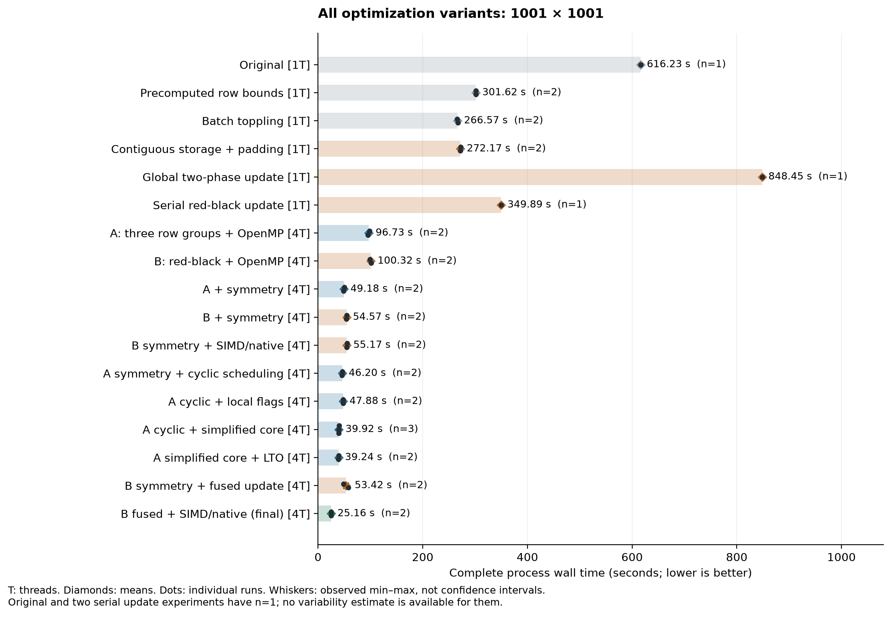
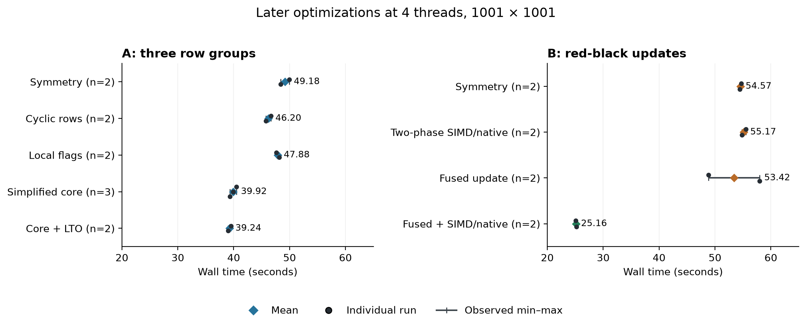
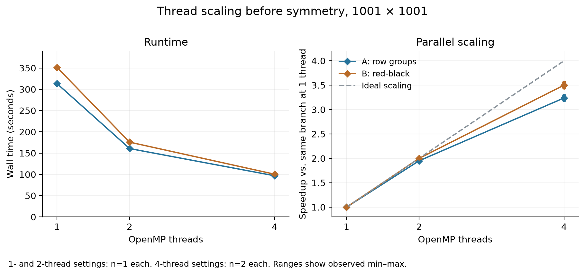

# Recorded performance results

The final implementation takes **25.162 seconds** on average
over two ordinary 1001 × 1001 runs, versus the original single ordinary run of
616.234 seconds: **24.49× speedup**,
or 95.92% less runtime.
The final observed range is 25.088–25.236 seconds;
sample SD is 0.105 seconds. The later clean-copy
verification run is excluded from these averages.

## Measurement scope

- [Bundled measurements](../data/measurements.csv): 36 ordinary runs, 21 version/thread settings.
- [Summary](../data/summary.csv), [original metadata](../data/measurement-records.json),
  [exclusions](../data/excluded-runs.csv), and [methodology](../data/methodology.json).
- All runs use size 1001. Time covers the complete program and PNG output;
  compilation, perf, phase timers, full-grid dumps, and packaging validation are excluded.
- Arithmetic means use all available ordinary runs, without excluding a warm-up.
  Most settings have two samples; simplified core has three. Single-sample settings
  have no estimated variability. Whiskers are observed min–max, not confidence intervals.
- Every included PNG was rechecked byte for byte against `identity-ref.png` during export.
  Early metadata fields that were not recorded remain blank; they are not reconstructed.
- See [reproduction instructions](experiments.md) for the course VM and build options.

## All versions

[Vector PDF](../figures/runtime_overview.pdf)

| Version | Threads | n | Mean (s) | Min–max (s) | Sample SD (s) | Speedup |
| --- | ---: | ---: | ---: | ---: | ---: | ---: |
| Original | 1 | 1 | 616.234 | 616.234–616.234 | — | 1.00× |
| Precomputed row bounds | 1 | 2 | 301.623 | 301.526–301.720 | 0.137 | 2.04× |
| Batch toppling | 1 | 2 | 266.574 | 266.075–267.074 | 0.706 | 2.31× |
| Contiguous storage + padding | 1 | 2 | 272.166 | 272.066–272.265 | 0.140 | 2.26× |
| Global two-phase update | 1 | 1 | 848.447 | 848.447–848.447 | — | 0.73× |
| Serial red-black update | 1 | 1 | 349.891 | 349.891–349.891 | — | 1.76× |
| A: three row groups + OpenMP | 1 | 1 | 313.239 | 313.239–313.239 | — | 1.97× |
| A: three row groups + OpenMP | 2 | 1 | 160.692 | 160.692–160.692 | — | 3.83× |
| A: three row groups + OpenMP | 4 | 2 | 96.726 | 95.421–98.031 | 1.846 | 6.37× |
| B: red-black + OpenMP | 1 | 1 | 351.297 | 351.297–351.297 | — | 1.75× |
| B: red-black + OpenMP | 2 | 1 | 175.759 | 175.759–175.759 | — | 3.51× |
| B: red-black + OpenMP | 4 | 2 | 100.325 | 98.855–101.794 | 2.078 | 6.14× |
| A + symmetry | 4 | 2 | 49.178 | 48.397–49.958 | 1.104 | 12.53× |
| B + symmetry | 4 | 2 | 54.568 | 54.457–54.679 | 0.157 | 11.29× |
| B symmetry + SIMD/native | 4 | 2 | 55.169 | 54.833–55.505 | 0.475 | 11.17× |
| A symmetry + cyclic scheduling | 4 | 2 | 46.205 | 45.746–46.664 | 0.649 | 13.34× |
| A cyclic + local flags | 4 | 2 | 47.883 | 47.606–48.160 | 0.391 | 12.87× |
| A cyclic + simplified core | 4 | 3 | 39.918 | 39.352–40.494 | 0.571 | 15.44× |
| A simplified core + LTO | 4 | 2 | 39.238 | 38.973–39.503 | 0.375 | 15.71× |
| B symmetry + fused update | 4 | 2 | 53.421 | 48.829–58.013 | 6.494 | 11.54× |
| **B fused + SIMD/native (final)** | 4 | 2 | 25.162 | 25.088–25.236 | 0.105 | 24.49× |

Speedup divides the original **single** ordinary time by each row's mean. These
values do not establish statistical significance. Trials were collected in development
order on a shared VM; host load and scheduling were not randomized or controlled.

## Later branch comparisons

[Vector PDF](../figures/late_optimizations.pdf)

- A's simplified core averages 39.918 seconds. Its LTO build is
  1.70% lower on average,
  a small observed difference with only two versus three samples.
- B's fused update alone averages 53.421 seconds, but ranges from
  48.829 to 58.013. Its apparent small gain over
  B symmetry is inconclusive given this observed spread.
- Fused SIMD/native reduces runtime by 52.90%
  relative to fused scalar, and 36.97%
  relative to A's simplified core. The SIMD directive and `-march=native` were enabled
  together, so their separate contributions have not been measured. The saved
  [compiler evidence](../data/vectorization.json) confirms vectorized stabilization loops.
- Padding alone increases runtime by 2.10%;
  global two-phase is 3.12× slower than padding.
  These unsuccessful intermediate designs were retained as foundations for later changes.
- Local termination flags increase runtime by 3.63%;
  SIMD/native on the earlier B two-phase design increases it by
  1.10%.
  Fewer barriers or vectorized loops alone did not guarantee an end-to-end gain.

Precomputed bounds avoid repeated geometry tests in the stabilization sweeps.
Batch toppling removes multiple groups of four grains per visit. Symmetry reduces
the simulated rows for odd sizes, with explicit center-row handling. Row grouping
and red-black phases arrange independent work for OpenMP; fused red-black updates
also make same-color cells independent within the vectorized loop. These explain
the intended mechanisms. Wall times alone do not isolate the cache, branch, or
synchronization cost of each design.

The earlier [profiling evidence](../data/profiling.json) puts 99.97% of the original
sampled CPU-cycle weight in `stabilize`. The later profile is of A symmetry,
not the final fused SIMD/native version. These profiles guide the optimization
sequence; their times are excluded from the ordinary timing table.

## Thread scaling

[Vector PDF](../figures/thread_scaling.pdf)

At four threads, A achieves 3.24×
and B achieves 3.50× relative to
their own single-thread settings. These compare the same algorithm at different
team sizes; they are distinct from speedup over the original algorithm.
Only A and B before symmetry were tested at all three team sizes.

## Correctness evidence

All included PNGs match the reference. The selected final algorithm also matched
the original in every one of 1,002,001 integer cells in two separate 4-thread runs.
[Validation summary](../data/validation-summary.json) and
[memory summary](../data/memory-summary.json) preserve the completed checks.
Valgrind used the same source with AVX-512 disabled; native ASan/UBSan was checked
separately. OpenMP TLS allocations reported as possibly lost/still reachable remain
documented, rather than being presented as zero in every leak category.
